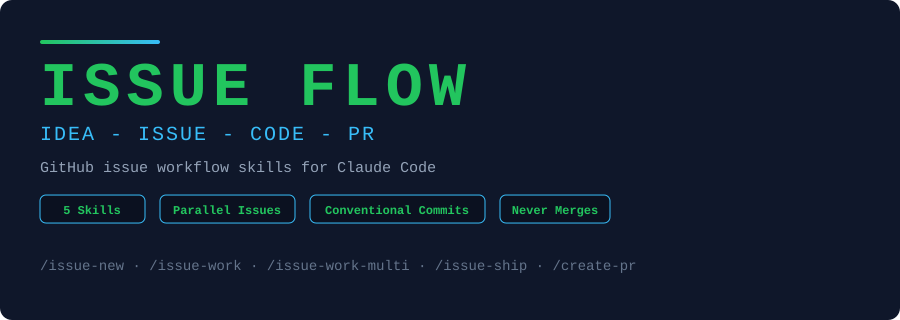

<p align="center">
  
</p>

<p align="center">
  <strong>Issue Flow para Claude Code.</strong> Transforme uma ideia em issue, implemente, teste, commite<br/>
  e abra o PR — 5 skills, issues em paralelo, tudo via <code>gh</code> e sem nunca fazer merge por você.
</p>

<p align="center">
  <a href="https://opensource.org/licenses/MIT"></a>
  
  
  
  
</p>

---

## Instalação

```bash
curl -fsSL https://raw.githubusercontent.com/guilhermetft/issue-flow/main/install.sh | bash
```

Um comando instala as 5 skills. Reinicie o Claude Code e rode `/issue-new`.

---

## O que é isso?

Issue Flow é um fluxo completo de trabalho com issues do GitHub, construído como skills do Claude Code. Cada etapa é uma skill: criar a issue, implementar, entregar e abrir o PR.

Nada é fixo por repositório. Owner, Project v2, colunas de Status e branch base são detectados em runtime. Funciona com ou sem Project.

Sem token extra, sem servidor, sem dependências. Só Claude Code e `gh`.

---

## Fluxo

```
   /issue-new            /issue-work <n>                /issue-ship <n>
 ┌─────────────┐       ┌──────────────────┐           ┌────────────────────┐
 │ ideia       │       │ Status → In      │           │ commit (Conv.      │
 │   ↓         │       │ progress         │           │ Commits + Closes)  │
 │ rascunho    │──────▶│ divide em tarefas│──┐        │ fecha a issue      │
 │   ↓         │       │ implementa       │  │        │ Status → Done      │
 │ você aprova │       │ roda testes      │  │        │   ↓                │
 │   ↓         │       └──────────────────┘  │        │ /create-pr         │
 │ issue +     │                             ▼        └─────────┬──────────┘
 │ Project     │                      ┌─────────────┐           │
 └─────────────┘                      │ VOCÊ REVISA │───────────┘
                                      └─────────────┘
                                                        PR aberto → merge é seu
```

Várias issues ao mesmo tempo:

```
                    /issue-work-multi 12 13 14
                               |
              ┌────────────────┼────────────────┐
              |                |                |
        ┌─────┴─────┐    ┌─────┴─────┐    ┌─────┴─────┐
        | subagent  |    | subagent  |    | subagent  |
        | issue #12 |    | issue #13 |    | issue #14 |
        | worktree  |    | worktree  |    | worktree  |
        └─────┬─────┘    └─────┬─────┘    └─────┬─────┘
              └────────────────┼────────────────┘
                               |
                 ┌─────────────┴──────────────┐
                 |      Revisão cruzada       |
                 | arquivos · contratos ·     |
                 | schema · build/testes      |
                 | + ordem de ship recomendada|
                 └────────────────────────────┘
```

---

## Todos os 5 comandos

### Planejar

| Comando | O que faz |
|---------|-----------|
| `/issue-new` | Cria a issue a partir de uma ideia: título Conventional Commits, contexto, tarefas e critérios de aceite. Adiciona ao Project e define o Status inicial. **Pede sua aprovação antes de criar.** |

### Implementar

| Comando | O que faz |
|---------|-----------|
| `/issue-work <n>` | Move a issue para *In progress*, quebra em tarefas, implementa (com subagents quando há trabalho independente) e roda/escreve testes. **Para para revisão, nunca commita.** |
| `/issue-work-multi <n1> <n2> ...` | Roda 2+ issues em paralelo, cada uma num subagent com worktree isolada. Depois faz **revisão cruzada** para achar conflito lógico entre elas. **Nunca commita.** |

### Entregar

| Comando | O que faz |
|---------|-----------|
| `/issue-ship <n>` | Só depois da sua aprovação: commita (`Closes #n`), fecha a issue, move para *Done* e abre o PR. |
| `/create-pr` | Abre o PR da branch atual (já commitada): título Conventional Commits, corpo curto, labels existentes, você como assignee. **Nunca faz merge.** |

---

## Garantias de segurança

| Regra | Onde vale |
|-------|-----------|
| **Nunca faz merge.** Entrega a URL do PR e para. | `create-pr`, `issue-ship` |
| **Nunca commita sem sua revisão.** | `issue-work`, `issue-work-multi` |
| **Confirma antes de criar issue** (ação visível a outros). | `issue-new` |
| **Nunca cria labels.** Usa só as que já existem. | `issue-new`, `create-pr` |
| **Nunca aplica migration sem você mandar.** | `issue-work-multi` |
| **Assignee é sempre você** (usuário autenticado no `gh`). | `issue-new`, `create-pr` |

---

## Revisão cruzada (`/issue-work-multi`)

Depois que cada subagent termina, as issues são comparadas entre si:

| Verificação | O que procura |
|-------------|---------------|
| Mesmo arquivo | Duas issues alterando a mesma região ou o mesmo arquivo |
| Contrato quebrado | Função, tipo, prop, rota, coluna ou env var renomeada/removida que outra issue ainda usa |
| Schema / dados | Migrations colidindo, mesma tabela alterada, coluna removida que outra lê |
| Config compartilhada | Rotas, menus, i18n, constantes, lockfile, barrels |
| Comportamento | Uma issue muda regra de negócio que a outra assume |
| Integração | Patches aplicados em sequência + build, lint e testes juntos |

Cada conflito sai com issues envolvidas, `arquivo:linha`, severidade (**bloqueia / atenção / informativo**) e correção proposta. O relatório termina com a **ordem de ship recomendada**.

---

## Exemplo de uso

### `/issue-new`

```
> /issue-new filtro de status na listagem de pedidos

Rascunho:
  Título:  feat: Filtro de status na listagem de pedidos
  Type:    Feature
  Labels:  enhancement

  ## Contexto
  Hoje não dá para filtrar pedidos por status...

  ## Tarefas
  - [ ] Adicionar select de status na listagem
  - [ ] Persistir filtro na URL

  ## Critérios de aceite
  - [ ] Filtrar por cada status retorna só os pedidos corretos

Criar? (s/n) s

✓ Issue #58 criada — https://github.com/acme/loja/issues/58
✓ Adicionada ao Project "Loja" · Status: Backlog · Assignee: @você
```

### `/issue-ship`

```
> /issue-ship 58

✓ Commit a1b2c3d — feat: Adiciona filtro de status na listagem. Closes #58
✓ Issue #58 fechada
✓ Status → Done
✓ PR aberto — https://github.com/acme/loja/pull/59

Merge é com você.
```

---

## Casos de uso

### Dev solo
Mantenha o board organizado sem esforço: cada ideia vira issue rastreável, cada issue vira commit com `Closes #n` e PR.

### Times pequenos
Padronize título (Conventional Commits), corpo, labels e assignee de issues e PRs, sem depender de disciplina manual.

### Várias frentes ao mesmo tempo
Use `/issue-work-multi` para tocar issues independentes em paralelo e descobrir conflitos antes do commit, não no PR.

### Repos com Project v2
Status é movido sozinho: *Backlog → In progress → Done*, com nomes detectados do seu board.

---

## Instalação

### Pré-requisitos

- **Claude Code**
- **[GitHub CLI](https://cli.github.com/)** autenticado, com escopo de Projects:
  ```bash
  gh auth login
  gh auth refresh -s project
  ```
- Repositório git com remote no GitHub
- **Windows:** rode o instalador no Git Bash ou WSL

### Instalação em uma linha

```bash
curl -fsSL https://raw.githubusercontent.com/guilhermetft/issue-flow/main/install.sh | bash
```

### Instalação manual

```bash
git clone https://github.com/guilhermetft/issue-flow.git
cd issue-flow
./install.sh              # global (~/.claude/skills)
./install.sh --project    # só no projeto atual (./.claude/skills)
./install.sh --force      # sobrescreve sem perguntar
```

### Desinstalação

```bash
curl -fsSL https://raw.githubusercontent.com/guilhermetft/issue-flow/main/uninstall.sh | bash -s -- --yes
```

Ou localmente:

```bash
./uninstall.sh              # global
./uninstall.sh --project    # projeto atual
./uninstall.sh --yes        # sem confirmação
```

Remove só as 5 skills deste repo; suas outras skills não são tocadas.

---

## Estrutura do projeto

```
issue-flow/
├── skills/
│   ├── issue-new/
│   │   ├── SKILL.md                # Cria a issue + Project + Status
│   │   └── templates/issue-body.md # Modelo do corpo da issue
│   ├── issue-work/SKILL.md         # Implementa uma issue (não commita)
│   ├── issue-work-multi/SKILL.md   # Várias issues em paralelo + revisão cruzada
│   ├── issue-ship/SKILL.md         # Commit + fecha issue + Done + PR
│   └── create-pr/
│       ├── SKILL.md                # Abre o PR (nunca faz merge)
│       └── templates/pr-body.md    # Modelo do corpo do PR
├── .github/
│   └── banner.svg
├── install.sh                      # Instalador (global ou --project)
├── uninstall.sh                    # Desinstalador
├── LICENSE
└── README.md
```

---

## Personalização

As skills são Markdown puro. Edite `SKILL.md` à vontade:

- corpo da issue e do PR: edite `templates/issue-body.md` e `templates/pr-body.md` (em `~/.claude/skills/issue-new/` e `~/.claude/skills/create-pr/`), sem mexer na lógica;
- idioma e formato das mensagens de commit;
- nomes de Status (*In progress*, *Done*) — há fallback para equivalentes;
- regra de autoria: `create-pr` e `issue-ship` proíbem Claude como co-author/assignee; remova essas linhas se quiser o contrário.

As skills estão escritas em português (pt-BR).

---

## Aviso

Estas skills automatizam ações no seu repositório GitHub (issues, commits, PRs, Status de Project). Revise sempre o que é proposto antes de aprovar, principalmente commits e migrations. Use por sua conta e risco.

---

<p align="center">
  <a href="https://opensource.org/licenses/MIT"></a>
</p>
